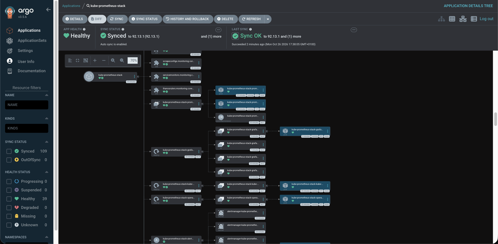
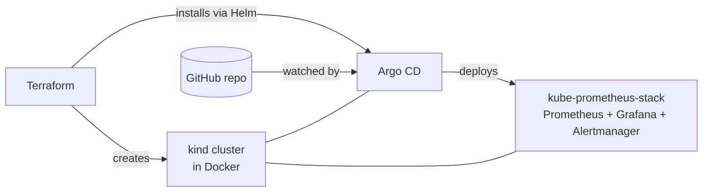
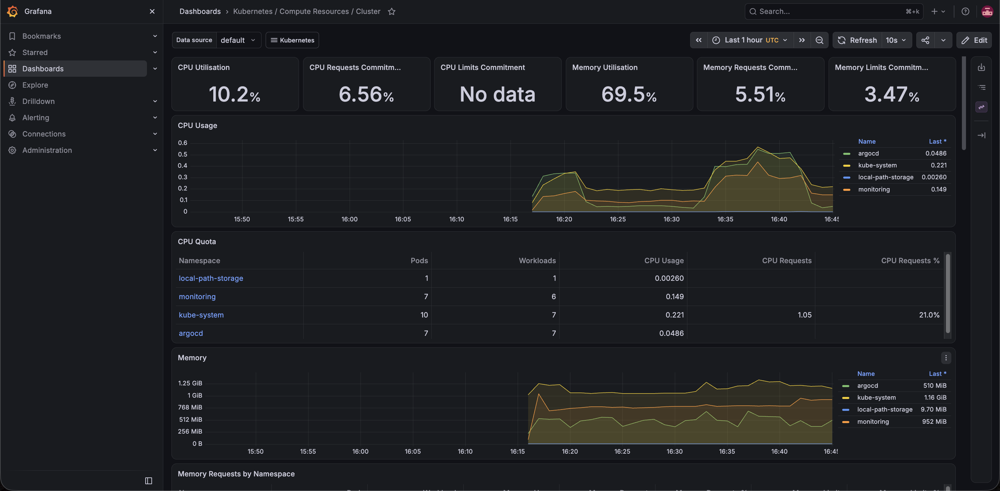

# k8s-gitops-lab

A local GitOps playground: a Kubernetes cluster running in Docker, provisioned
with **Terraform**, continuously deployed by **Argo CD**, and monitored with
**Prometheus** and **Grafana**. Everything is declarative and reproducible with
a few commands, at zero cost.



## Architecture



1. **Terraform** provisions the kind cluster and bootstraps Argo CD.
2. **Argo CD** uses the _app-of-apps_ pattern: a root application watches
   `argocd/apps/` and creates a child application for each manifest in it.
3. **kube-prometheus-stack** is deployed from the upstream Helm chart, with
   custom values stored in this repo (`monitoring/`).
4. Any change pushed to Git is synced to the cluster automatically
   (`prune` and `selfHeal` enabled).

## Repository structure

```
├── terraform/    # kind cluster + Argo CD (Helm provider)
├── argocd/       # root app + child Application manifests
├── monitoring/   # Helm values for kube-prometheus-stack
└── docs/images/  # screenshots
```

## Prerequisites

Docker, kind, kubectl, Terraform (>= 1.5), Helm.
Tested on macOS with Docker Desktop and 8 GB RAM, using 1 control-plane node
and 1 worker. With more RAM, raise `worker_count`.

## Quick start

```bash
git clone https://github.com/mlietti1/k8s-gitops-lab.git
cd k8s-gitops-lab/terraform

# Look up the current chart version and set it in terraform.tfvars
terraform init
terraform apply

kind export kubeconfig --name gitops-lab
kubectl apply -f ../argocd/root-app.yaml
```

> If you fork this repo, update `repoURL` in `argocd/root-app.yaml` and
> `argocd/apps/*.yaml` to point to your fork.

## Accessing the UIs

| Service    | Command                                                                             | URL                   | Credentials                               |
| ---------- | ----------------------------------------------------------------------------------- | --------------------- | ----------------------------------------- |
| Argo CD    | `kubectl port-forward svc/argocd-server -n argocd 8080:80`                          | http://localhost:8080 | `admin` / see command below               |
| Grafana    | `kubectl port-forward svc/kube-prometheus-stack-grafana -n monitoring 3000:80`      | http://localhost:3000 | `admin` / `prom-operator` (chart default) |
| Prometheus | `kubectl port-forward svc/kube-prometheus-stack-prometheus -n monitoring 9090:9090` | http://localhost:9090 | none                                      |

Argo CD initial admin password:

```bash
kubectl -n argocd get secret argocd-initial-admin-secret \
  -o jsonpath="{.data.password}" | base64 -d; echo
```



## GitOps in action

1. Edit `monitoring/kube-prometheus-stack-values.yaml` (e.g. change `retention`).
2. Commit and push.
3. Argo CD detects the change and syncs the cluster, with no `kubectl` or
   `helm` needed.

Manual changes to the cluster are reverted by `selfHeal`.

## Design decisions

- **kind instead of a cloud cluster**: free and quick to recreate, and it
  keeps the focus on the workflow.
- **Terraform only bootstraps**: infrastructure and Argo CD are Terraform's job;
  everything running on the cluster is managed through Git.
- **Pinned versions**: provider lock file and Helm chart versions are committed
  for reproducibility.
- **Control-plane metrics disabled**: kind exposes etcd, scheduler and
  controller-manager only on localhost, so Prometheus can't scrape them.

## Limitations (lab setup, not production)

- Argo CD runs with `server.insecure=true` and is reached via port-forward.
- Grafana uses the chart's default admin password.
- No persistent storage, TLS, ingress or authentication.

## Cleanup

```bash
cd terraform && terraform destroy
```

## Possible next steps

- Ingress controller and local TLS
- Alert rules and a custom Grafana dashboard
- Deploy a sample app with its own `ServiceMonitor`
- CI pipeline running `terraform fmt` and `validate`
